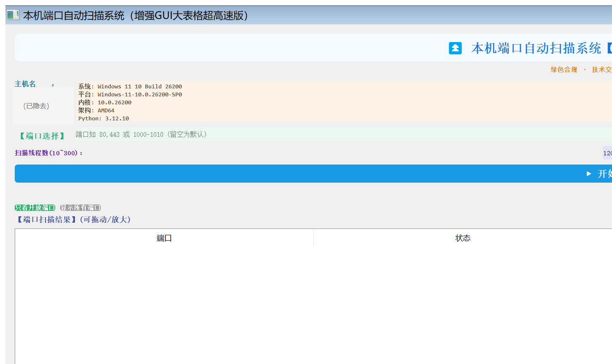

# 本机 TCP 端口扫描器

一个基于 **Python + PyQt5** 的 Windows 本机 TCP 端口扫描与结果展示工具。项目把 socket 扫描、并发任务调度和桌面 GUI 组合成一个可运行、可打包、便于面试讲解的小型工程。

## 项目简介与适用场景

程序启动后读取本机主机名、IP 和系统信息，并对本机 IP 的指定 TCP 端口执行连接探测。扫描结果会实时显示端口、状态、耗时和服务/协议名称。

适合以下场景：

- 学习 TCP `connect_ex`、端口状态和服务名解析；
- 排查本机开发服务是否监听在预期端口；
- 演示 PyQt5 GUI、`QThread`、`Queue` 和工作线程协作；
- 在获得授权的实验环境中进行小范围验证。

本项目不是网络资产发现平台，也不包含远程主机批量扫描、漏洞利用或结果上传功能。

## 界面截图



主界面展示本机信息、端口输入、扫描控制和结果表格。

## 功能矩阵

| 能力 | 当前实现 | 说明 |
| --- | --- | --- |
| 本机信息 | ✅ | 显示主机名、本地 IP、Windows/平台信息 |
| 端口输入 | ✅ | 支持单端口、逗号分隔和区间，例如 `80,443`、`1000-1010` |
| 默认端口 | ✅ | 未输入时扫描内置常见端口与 `1-1024` |
| 全端口扫描 | ✅ | 可选 `1-65535`，启动前提示资源和耗时风险 |
| 并发扫描 | ✅ | `QThread` 承载扫描流程，内部使用任务队列和受限工作线程 |
| 实时进度 | ✅ | 通过 Qt signal 更新进度条和提示文本 |
| 结果筛选 | ✅ | 默认只看开放端口，可切换为全部扫描结果 |
| 极速模式 | ✅ | 使用更短 socket 超时，并且只发出开放端口结果 |
| 结果保存 | ✅ | 保存当前扫描结果为文本文件 |
| 可执行文件构建 | ✅ | 提供 PyInstaller `.spec` 文件 |

## Windows 安装与运行

在项目根目录打开 PowerShell：

```powershell
python -m venv .venv
.venv\Scripts\activate
python -m pip install --upgrade pip
pip install PyQt5
python "端口扫描系统软件.py"
```

如果 PowerShell 的执行策略阻止激活脚本，也可以直接使用 `.venv\Scripts\python.exe` 执行后续命令；这不会改变项目代码。

## 使用流程

1. 启动程序，确认顶部显示的本机主机名和 IP。
2. 在端口输入框填写端口，例如 `80,443,8080` 或 `8000-8010`；留空使用默认端口集合。
3. 按需设置扫描线程数。界面允许的范围是 `10~300`，不合法输入会回退到默认值。
4. 需要时勾选“全部 1-65535 端口”或“极速模式”。全端口扫描可能耗时较长，应谨慎使用。
5. 点击“开始扫描”，通过进度条观察进度；扫描期间相关控件会暂时禁用。
6. 扫描完成后，在“只看开放端口”和“显示所有端口”之间切换，或使用“保存结果”导出文本。

## 架构概览

核心数据流为：

```text
MainWindow
    -> PortScannerThread (QThread)
        -> Queue
            -> worker threads
        -> Qt signals
    -> result table
```

GUI 线程只负责窗口和控件；socket 连接探测由 `PortScannerThread` 启动的 Python worker threads 执行。worker 从 `Queue` 领取端口，完成后通过 `progress` 和 `result` signal 把进度、状态和耗时交回 `MainWindow`，由 Qt 事件循环更新表格。因此扫描等待不会直接阻塞 GUI。完整说明见 [`docs/architecture.md`](docs/architecture.md)。

## 性能说明

- 每个端口使用 TCP `connect_ex`，超时由普通模式约 `0.22s`、极速模式约 `0.075s` 控制；实际耗时还受操作系统、网络栈和目标端口状态影响。
- 并发数由界面限制在 `10~300`，实际 worker 数不会超过待扫描端口数。
- 线程数增加不等于线性加速；过大的端口范围和超时连接会消耗 socket、CPU、内存及本机网络资源。
- 进度按已处理端口计数，不代表精确剩余时间。极速模式不发出关闭端口结果，所以表格更简洁，但不是“只扫描开放端口”。

## 安全与合规边界

仅扫描自己拥有或明确获准测试的主机和端口。未经授权扫描第三方系统可能违反法律、服务条款或组织安全政策。建议：

- 优先使用 `127.0.0.1`、个人开发机或隔离实验网络；
- 从小端口集合开始，避免未经评估的全端口扫描；
- 不将扫描结果、主机信息或日志提交到公开仓库；
- 将本工具视为连通性诊断工具，不把“开放端口”解读为漏洞结论。

程序没有身份认证、权限控制、审计、远程扫描授权和云端上传机制；这些能力不存在于当前源码中。

## PyInstaller 构建

仓库已提供 `端口扫描系统软件.spec`，在已安装依赖的环境中运行：

```powershell
python -m pip install pyinstaller
pyinstaller "端口扫描系统软件.spec"
```

构建输出由 PyInstaller 写入 `build/` 和 `dist/`，这些目录不应提交。spec 使用窗口模式生成名为“端口扫描系统软件”的 Windows executable。

## 当前限制

- 目标地址取自本机 IP，不能配置远程主机或一次扫描多个主机。
- 只做 TCP 连接层探测，不识别 UDP，不进行 banner grabbing、漏洞检测或服务深度探测。
- 服务名称来自本机 `socket.getservbyport` 数据，未知服务会显示“未知服务”。
- 当前 `stop()` 会阻止 worker 领取新任务，但 `PortScannerThread.run()` 仍会等待 `Queue.join()`；队列中尚未领取的任务不会调用 `task_done()`，因此在大范围扫描中停止或关闭窗口可能阻塞。这是当前实现限制，停止操作不一定能可靠地结束扫描。
- 结果保存在内存中，程序关闭后不会自动恢复历史扫描。
- 当前是单文件应用，缺少自动化 GUI 测试、持久化配置和国际化。

## 面试亮点

- **GUI 与 I/O 解耦**：用 `QThread` 承载扫描生命周期，用 Qt signal 将结果安全交给主线程，避免在槽函数中直接操作跨线程 UI。
- **任务分发**：用线程安全 `Queue` 将端口任务分给固定数量 worker，避免为每个端口创建线程。
- **可解释的模式取舍**：普通模式保留开放/关闭结果；极速模式缩短超时并省略关闭结果，以更快看到有价值的开放端口。
- **渐进式风险控制**：线程数有上下限，全端口扫描前确认，文档明确授权和资源边界。
- **可交付性**：同一份源码既可直接运行，也可通过现有 spec 用 PyInstaller 构建。

更多追问答案见 [`docs/interview-notes.md`](docs/interview-notes.md)。
